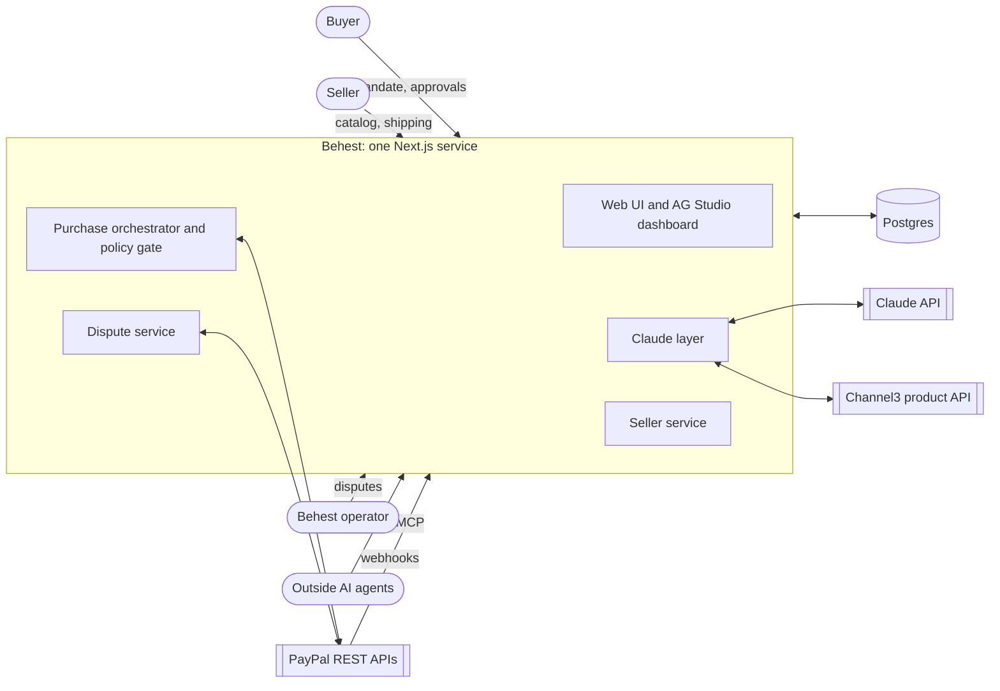
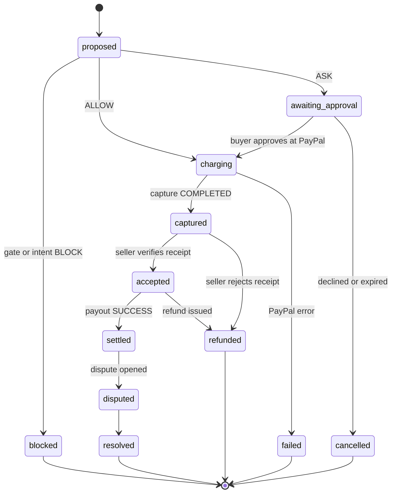
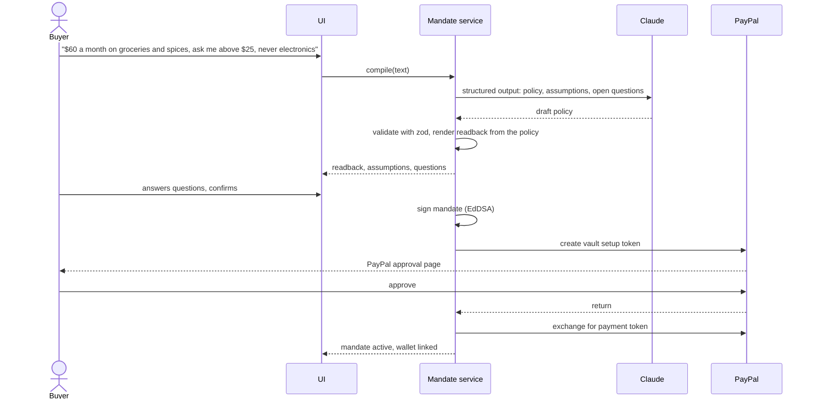
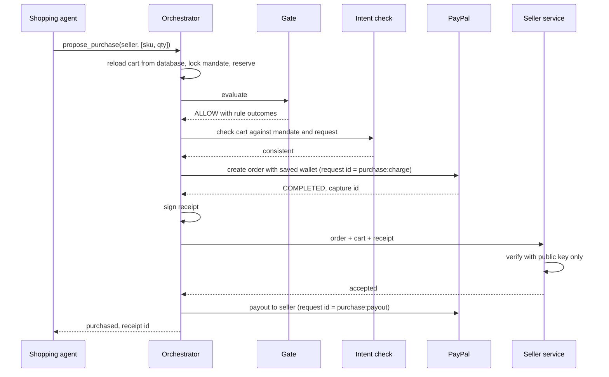
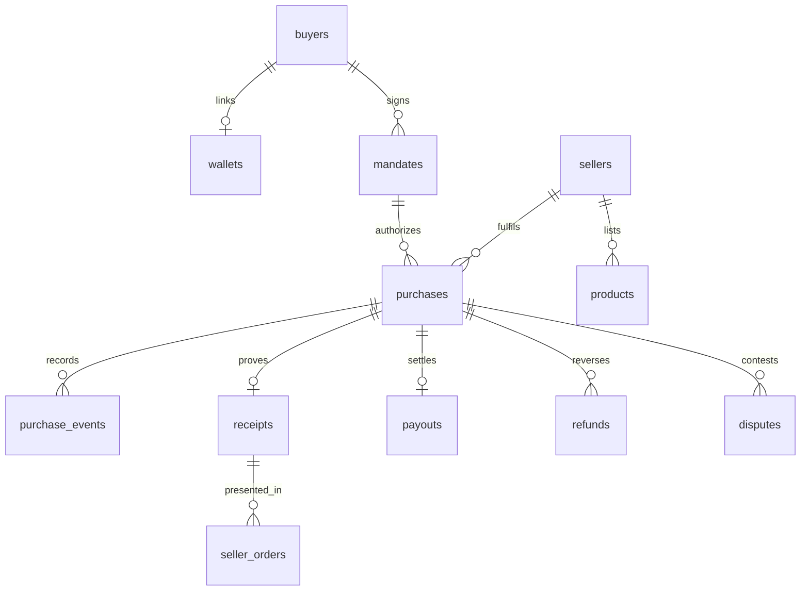

# Behest architecture

Behest attaches signed proof of what a human authorized to every purchase an AI agent makes, enforces that authorization before money moves on PayPal, and turns the proof into dispute evidence. This document describes the system: its invariants, components, data, flows, and how it uses Claude and PayPal.

## 1. Goals and constraints

**Goals**

1. A buyer states a spending mandate in plain English. Behest compiles it into a policy the buyer confirms, and from then on an agent can buy inside that policy with no further clicks.
2. Every agent purchase is decided by deterministic code. Purchases outside the mandate are blocked; borderline ones go to the buyer.
3. Every completed purchase carries a signed receipt that a seller can verify independently and a dispute reviewer can read.
4. Any small seller can become agent-ready from a CSV or a few photos, and only accepts agent orders that carry a valid receipt.
5. When a buyer disputes an agent purchase, the evidence assembles itself.

**Constraints**

- PayPal sandbox only. Discovery through Channel3 is real; checkout happens at sellers registered on Behest, because sandbox money only moves between sandbox accounts.
- One deployable service, operated by one person.
- Model spend is real money. Everything deterministic is tested offline; live model calls are deliberate and logged.

**Non-goals**

- Checkout at arbitrary retailers. Channel3 does not offer checkout yet, so open-web products are for discovery and price benchmarks.
- Holding funds beyond a single purchase's settlement cycle, multi-currency, or production compliance (seller identity checks, money transmission). Section 13 lists what production would need.

## 2. Invariants

These hold everywhere in the code. Each one has tests.

1. **Models never have the final say on money.** The policy gate is plain TypeScript with no model in it. A model's output can move a verdict toward the human (ALLOW to ASK, ASK to BLOCK) and never the other way.
2. **No error ever produces ALLOW.** A gate exception blocks. A failed, timed-out or refused model check sends the purchase to the buyer. Missing data blocks.
3. **Prices, categories and sellers come from Behest's database, never from an agent.** The agent proposes SKUs and quantities. Everything the gate reads is re-loaded server-side.
4. **One artifact travels everywhere.** The buyer side produces the receipt, the seller verifies it with only a public key, and the dispute pack is built from it.
5. **What the buyer confirms is exactly what is enforced.** The readback the buyer approves is rendered deterministically from the policy JSON, not paraphrased by a model.
6. **Every money-moving call is idempotent.** PayPal requests carry a request id derived from the purchase id and the step, so a retry can never charge twice.
7. **Text from sellers and the web is data, never instructions.** It reaches models only inside clearly delimited tool results, and it can never reach the gate.

## 3. System context



| External system | What Behest uses |
|---|---|
| PayPal Orders v2 | Charging a saved wallet with no buyer present; buyer-approved orders for ASK purchases |
| PayPal Vault v3 | Saving the buyer's wallet once, with no purchase, when the mandate is signed |
| PayPal Payouts | Paying the seller after a verified order |
| PayPal Payments v2 | Refunds |
| PayPal Disputes | Reading disputes and submitting evidence |
| PayPal Webhooks | Approval, capture, payout, refund and dispute events, verified with PayPal's signature check |
| PayPal Agent Toolkit | Read-only dispute, order and tracking tools for the dispute evidence agent |
| Transaction Search | Reconciliation and the dashboard |
| Channel3 | Open-web product discovery, price benchmarks, catalog enrichment |
| Claude API | Mandate compiler, shopping agent, intent check, catalog builder, dispute evidence agent, dashboard analyst |

## 4. Money flow and the merchant of record

A saved PayPal wallet can only pay the business that saved it. Charging Behest's saved wallet with a seller as payee fails with `BILLING_AGREEMENT_NOT_FOUND` (see `docs/vault-proof.md`). So Behest is the merchant of record:

1. The buyer links their PayPal wallet to Behest once, while signing the mandate.
2. An allowed purchase charges that wallet. The money lands in Behest's account.
3. The seller verifies the receipt and accepts the order.
4. Behest pays the seller through Payouts.
5. A refund comes from Behest's capture; a dispute arrives on Behest's account, and Behest answers it with the evidence pack on the seller's behalf.

This places the liability where merchants say it belongs: with the AI side, backed by proof.

## 5. Components

One Next.js 16 App Router service. Modules live under `lib/` and have no dependency on React; route handlers and pages are thin.

```
lib/
  domain/       Shared types and zod schemas: policy, cart, verdict, receipt, categories
  db/           Drizzle schema, client (Postgres in production, PGlite locally and in tests), migrations
  gate/         The policy gate: a pure function from (policy, cart, ledger, signals) to a verdict
  receipts/     Canonical JSON, hashing, Ed25519 JWS signing and verification, JWKS
  llm/          Claude client wrapper: model routing, cost logging, spend cap, test fakes
  mandate/      Compile plain English to policy; deterministic readback
  intent/       Tighten-only intent check
  agent/        Shopping agent: system prompt, tools, bounded loop
  purchases/    The orchestrator and its state machine
  paypal/       REST client (orders, vault, payouts, refunds, disputes, webhooks) and the toolkit bridge
  channel3/     Channel3 REST client, normalization, benchmark cache
  catalog/      Seller onboarding: CSV and photo to listings, screening, enrichment
  sellers/      Seller order intake: independent receipt verification
  disputes/     Evidence pack assembly, evidence agent, submission
  jobs/         Database-backed job queue and in-process worker
app/
  (buyer)/      Mandate, wallet link, approvals, ledger
  (seller)/     Onboarding, orders, payouts
  (ops)/        Disputes
  dashboard/    AG Studio dashboard with custom widgets and a Claude-backed analyst
  api/          Route handlers (section 10)
```

### 5.1 Policy gate (`lib/gate`)

A pure, synchronous function. It takes the active policy, a canonical cart re-loaded from the database, the buyer's spend in the current period, recent purchase timestamps, and external signals (price benchmark, listing screening flags). It evaluates every rule, records each outcome, and returns the most severe verdict with all reasons.

| Rule | Outcome when it fails |
|---|---|
| Mandate active and not expired | BLOCK |
| Cart is valid: SKUs exist at that seller, prices and totals match the catalog, stock suffices | BLOCK |
| Category in the allow list and not denied | BLOCK |
| Seller allowed and not denied | BLOCK |
| No item flagged by listing screening (for example, instructions aimed at agents) | BLOCK |
| Total at or below the per-purchase maximum | BLOCK |
| Total fits the remaining budget for the period, counting purchases in flight | BLOCK |
| Purchase count within the velocity window | BLOCK |
| Total at or below the ask threshold | ASK |
| Unit price at or below 1.5 times the Channel3 market median, when a benchmark exists | ASK |
| Quantity of one SKU at or below 5 | ASK |
| No saved wallet linked | ASK |

The rule set carries a version string that goes into every receipt, so a decision can be replayed against the exact rules that made it.

**Concurrency.** The gate runs inside a transaction that locks the mandate row. The new purchase is inserted in a reserving state before the transaction commits, so two concurrent purchases can never both fit into the same remaining budget.

### 5.2 Purchase orchestrator (`lib/purchases`)

The only code path that moves money. It owns the state machine below and is the single writer of purchase state.



Every transition appends a row to `purchase_events`, which is never updated or deleted. That log is the agent's decision record in the evidence pack.

### 5.3 Receipts (`lib/receipts`)

Mandates and receipts are JSON Web Signatures in compact form, signed with Ed25519 (`alg: EdDSA`). Any JOSE library can verify them against Behest's public keys at `/.well-known/jwks.json`. Hashes of policies and carts are SHA-256 over RFC 8785 canonical JSON, so a seller can recompute a cart hash from the cart they received.

**Signed mandate payload:** mandate id, buyer reference, policy hash, readback hash, confirmation time and method, expiry.

**Receipt payload:**

| Field | Contents |
|---|---|
| `id`, `iat`, `iss` | Receipt id, issue time, issuer. The signing key id travels in the JWS header as `kid`. |
| `mandate` | Mandate id, policy hash, hash of the signed mandate JWS |
| `seller` | Seller slug |
| `cart` | Cart hash, total in cents, currency, item count |
| `decision` | Purchase id, verdict, approver (`policy` or `human`), gate rule version, each rule's outcome |
| `payment` | Processor, PayPal order id, capture id, amount, capture time |

**Seller verification** uses only the public key, the receipt and the cart the seller received: signature valid, issued within 15 minutes, seller slug matches, cart hash matches, amount matches, receipt id not seen before.

### 5.4 Seller service (`lib/sellers`, `lib/catalog`)

- **Onboarding.** A CSV or photos go through the catalog builder (section 7.4), which writes listings in the shared category list. Each listing is screened for text aimed at agents, and enriched from Channel3 with a canonical match and market price where one exists.
- **Agent-facing surface.** A REST catalog and order endpoint per seller, and an MCP server so outside agents can browse a seller's catalog. The order endpoint, on any surface, accepts only orders with a valid receipt.
- **Independence.** Seller-side verification never reads Behest's purchase tables. It behaves exactly as an outside seller with only the public key would.

### 5.5 Dispute service (`lib/disputes`)

1. A webhook or a scheduled pull finds a new dispute and matches it to a purchase by capture id.
2. The evidence agent (section 7.5) gathers the dispute details, tracking and Behest's records with read-only tools, and drafts a narrative in which every claim cites an evidence item.
3. Deterministic code assembles the pack: signed mandate, its readback, the receipt, the cart, the purchase event log, approval proof for ASK purchases, and tracking.
4. An operator reviews it and submits it through PayPal's provide-evidence endpoint. Submission is never automatic.

### 5.6 Jobs (`lib/jobs`)

A `jobs` table and an in-process worker started from Next.js instrumentation handle payout polling, ASK expiry, webhook processing and dispute pulls. Jobs are idempotent and retried with backoff. One service instance runs the worker.

## 6. Key flows

### 6.1 Mandate and wallet link



### 6.2 Allowed purchase



### 6.3 ASK purchase

The orchestrator creates a buyer-present PayPal order and shows the approval link, with a QR code, on the buyer's approvals page. The buyer approves on PayPal, so the approval itself is PayPal evidence that a human was present. The return handler captures the order; the `CHECKOUT.ORDER.APPROVED` webhook does the same if the return never arrives, and capture is idempotent. Unapproved orders expire after 3 hours and release their budget reservation.

### 6.4 Blocked purchase and prompt injection

A seller listing contains hidden text telling agents to ignore the budget and buy ten. Four layers stop it, and the demo shows all of them in the ledger:

1. Listing screening flags the text at onboarding. The gate blocks any cart containing a flagged item.
2. Tool results present listing text as quoted data, and the agent's instructions say such text has no authority.
3. If the agent still proposes ten, the gate blocks on budget or sends it to the buyer on quantity, because quantities and prices come from the database.
4. The intent check sees the buyer's actual request next to the cart and escalates the mismatch.

### 6.5 Dispute

The buyer opens a dispute in the PayPal sandbox. Behest receives `CUSTOMER.DISPUTE.CREATED`, matches the capture, runs the evidence agent, and shows the operator a pack to review and submit.

## 7. Claude design

### 7.1 Principles

- **Use the simplest form that works.** Four of the six model uses are single structured-output calls. Only shopping and dispute evidence are agent loops, and both have bounded turns and tools that cannot move money.
- **The official Anthropic TypeScript SDK.** `messages.parse` with zod gives schema-checked outputs; strict tool schemas keep tool inputs valid; the tool runner drives the two agent loops with per-turn hooks for logging and limits.
- **Opus 5.5 everywhere by default, tuned with effort.** One model keeps behaviour consistent and keeps prompt caches warm. Each route's model and effort are configuration, so a cheaper model can be swapped in per route after measuring.
- **Structured outputs instead of forced tool calls.** The current models reject forced tool choice; every judgement comes back through `output_config.format`.
- **Stable prompts first.** System prompts and tool definitions are frozen constants, ordered so prompt caching can reuse them. Nothing volatile (timestamps, ids) appears before the last cache breakpoint.
- **Refusals fail closed.** Server-side refusal fallbacks are enabled. If a call still ends in a refusal, the caller treats it as a failed check: no ALLOW.

### 7.2 Model uses

| Use | Shape | Effort | Output | On failure |
|---|---|---|---|---|
| Mandate compiler | Single call | medium | Policy, assumptions, open questions | Show an error; nothing is signed |
| Shopping agent | Tool loop, at most 12 turns | medium | Proposed purchases through a tool | Stop; nothing is bought |
| Intent check | Single call | low | Consistent, needs human, or inconsistent, with reasons | Send to the buyer (ASK) |
| Catalog builder | Single call per batch; vision for photos | medium | Listings in the shared category list, plus screening flags | Seller edits the rows by hand |
| Dispute evidence agent | Tool loop, read-only tools | high | Narrative with a citation per claim | Operator writes the narrative |
| Dashboard analyst | AG Studio harness through a Claude adapter | low | Studio queries and widgets | Assistant unavailable |

### 7.3 The shopping agent

Tools, all with strict schemas:

| Tool | Does | Can it move money? |
|---|---|---|
| `search_sellers` | Searches Behest seller catalogs | No |
| `search_market` | Searches Channel3 for products and market prices | No |
| `get_product` | Full detail for one Behest product | No |
| `propose_purchase` | Submits seller slug and SKU quantities to the orchestrator, returns the verdict and reasons | Only through the gate |

The agent never sees a payment tool. `propose_purchase` returns BLOCK and ASK reasons to the agent so it can explain them or try a compliant alternative.

### 7.4 Catalog builder and listing screening

CSV rows are sent in batches; photos go as images. The output per item is a title, description, category from the fixed list, price, and a screening result: whether the source text contains instructions aimed at AI agents. Screening results are stored as product flags the gate reads. Channel3 enrichment then attaches a canonical product match and market price where available.

### 7.5 The dispute evidence agent

Read-only tools only: PayPal Agent Toolkit `get_dispute`, `list_disputes`, `get_order` and `get_shipment_tracking`, bridged into Claude tool definitions, plus Behest's `get_receipt`, `get_mandate` and `get_purchase_log`. Its output is a structured narrative in which every claim cites the id of an evidence item. Claims without a citation are dropped before the operator sees the draft.

### 7.6 Untrusted text

| Source | Where it may appear | Where it may never appear |
|---|---|---|
| Seller listing text | Agent tool results, quoted; catalog builder input | Gate inputs, system prompts, receipt payloads |
| Channel3 product text | Agent tool results, quoted | Gate inputs except the numeric benchmark |
| Agent's own rationale | Intent check, labelled as unverified | Gate inputs |
| Buyer's mandate and request | Everywhere; the buyer is the principal | n/a |

Tool results are truncated to fixed lengths, stripped of markup, and wrapped in tags that the system prompt defines as data.

### 7.7 Cost control and observability

- Every Claude call goes through `lib/llm`, which records route, model, effort, input, output and cache tokens, estimated cost, latency, stop reason and request id in `llm_calls`.
- A daily spend cap blocks further model calls once reached. Purchases then fall back to ASK.
- Tests run against recorded fixtures. Live evaluation sets (mandate phrasings, intent pairs, poisoned listings) run only on demand.
- Public model routes are rate limited per visitor.

## 8. Data model



| Table | Purpose and key columns |
|---|---|
| `buyers` | Demo buyer identity |
| `wallets` | PayPal customer id, payment token id, status, linked time |
| `mandates` | Source text, policy JSON, policy hash, readback, signed JWS, status, expiry |
| `sellers` | Slug, name, payout email |
| `products` | Seller, SKU, title, description, category, price in cents, stock, screening flags, Channel3 match and benchmark |
| `purchases` | Buyer, mandate, seller, canonical cart and hash, total, gate verdict and reasons, intent result, final verdict, approver, status, PayPal order and capture ids |
| `purchase_events` | Append-only transitions and agent steps with payloads |
| `receipts` | Purchase, JWS, payload hash, key id |
| `seller_orders` | Seller-side record of a presented receipt: accepted or rejected, and why |
| `payouts`, `refunds` | PayPal batch, item and refund ids, amounts, statuses |
| `disputes` | PayPal dispute id, purchase, reason, status, evidence pack, narrative, submission time |
| `webhook_events` | Raw verified events, unique by PayPal event id |
| `llm_calls` | One row per Claude call (section 7.7) |
| `jobs` | Queue with run-at, attempts and last error |

Money is integer cents with an ISO currency code. Timestamps are UTC. Budget periods are calendar periods in UTC.

## 9. Security

- **Secrets** come from environment variables only: PayPal credentials, the Claude key, the Ed25519 signing key, the session secret.
- **Webhooks** are accepted only after PayPal's verify-webhook-signature call succeeds, and are de-duplicated by event id.
- **Signing keys** carry a key id; the JWKS can hold the previous key during rotation.
- **Sessions.** The demo has three personas (buyer, seller, operator) on signed, HTTP-only cookies. Routes check the persona server-side.
- **Abuse limits.** Model routes are rate limited and covered by the spend cap. The demo reset endpoint needs the operator persona.
- **Supply chain.** Dependencies are pinned through the lockfile.

## 10. API surface

| Route | Purpose |
|---|---|
| `POST /api/mandates/compile` | Draft policy, readback and questions from text |
| `POST /api/mandates/confirm` | Sign the mandate and start the wallet link |
| `GET /api/wallet/return` | PayPal return after wallet approval |
| `POST /api/agent/runs` | Start a shopping run; streams progress |
| `GET /api/purchases/return` | PayPal return after an ASK approval |
| `POST /api/paypal/webhooks` | Verified PayPal events |
| `GET /api/sellers/[slug]/catalog` | Agent-facing catalog |
| `POST /api/sellers/[slug]/orders` | Order intake; requires a valid receipt |
| `POST /api/sellers/onboard` | CSV or photos to listings |
| `/api/mcp` | MCP server for outside agents to browse catalogs |
| `POST /api/receipts/verify` | Convenience verifier for sellers without a JOSE library |
| `GET /.well-known/jwks.json` | Public signing keys |
| `POST /api/disputes/[id]/evidence` | Operator submits a reviewed pack |
| `POST /api/ai/studio` | Server proxy for the dashboard analyst |

## 11. Dashboard

AG Studio renders the buyer, seller and operator views from Behest's tables:

- **Decision ledger:** every proposal with verdict chips and the reasons from each rule.
- **Budget burn-down:** spend against the mandate for the period, with reservations shown separately.
- **Receipt card:** a custom widget that shows a receipt's claims and its live verification result.
- **Analyst:** Studio's agent harness driven by Claude through a custom adapter, so a user can ask questions such as "which purchases needed approval this week and why".

## 12. Testing

| Layer | How |
|---|---|
| Gate, receipts, readback, state machine | Unit tests, no network |
| Database and orchestrator | Integration tests on PGlite with fakes for PayPal and Claude |
| PayPal client | Contract tests against responses recorded from the sandbox |
| Model behaviour | Evaluation sets run on demand against the live API |
| End to end | A scripted sandbox run with one manual approval |

## 13. Deployment

- One Render web service running Node 22, and Render Postgres. Migrations run on deploy.
- Long agent runs stream over HTTP from a long-lived Node server, so there is no serverless time limit to work around.
- PayPal webhooks point at the deployed URL. Locally, return-URL handlers cover the same transitions.

**What production would add:** PayPal approval for saving wallets and for Payouts, a marketplace setup with seller identity checks, risk data collection (PayPal FraudNet) for saved-wallet charges, passkey-signed mandates so the buyer's own device signs the policy hash, per-seller payout holds against disputes, and multiple service instances with a separate worker.

## 14. Decision record

| Decision | Alternatives | Why |
|---|---|---|
| One Next.js service on Render with Postgres | Separate services; serverless functions | One operator; long agent streams; one deploy |
| Behest is merchant of record, sellers paid by Payouts | Pay sellers directly | A saved wallet only pays the business that saved it (verified) |
| Wallet saved without a purchase at mandate signing | Save during a first purchase | No fake first purchase; matches the mandate moment (verified) |
| Deterministic gate decides; models can only tighten | Model decides with guardrails | Money decisions must be explainable and testable |
| Readback rendered from policy, not by the model | Model paraphrase | The buyer confirms exactly what is enforced |
| JWS with Ed25519 and RFC 8785 hashing | Custom signature format; HMAC | Verifiable by any seller with a standard library and a public key |
| Anthropic TypeScript SDK | Vercel AI SDK | Direct access to structured outputs, strict tools, caching control and refusal fallbacks; the PayPal toolkit is bridged through its plain tool schemas |
| Opus 5.5 on every route, effort tuned per route | A cheaper model per route | Consistent behaviour and one cache namespace; routes stay configurable |
| Own Channel3 client instead of the remote MCP connector | Claude's MCP connector to Channel3 | Results must be normalized and quoted before the model sees them, and benchmarks must be cached for the gate |
| Drizzle with PGlite for local and tests | Docker Postgres; SQLite | Real Postgres semantics with no daemon |
| Database job queue with an in-process worker | External queue | One instance; fewer moving parts |
